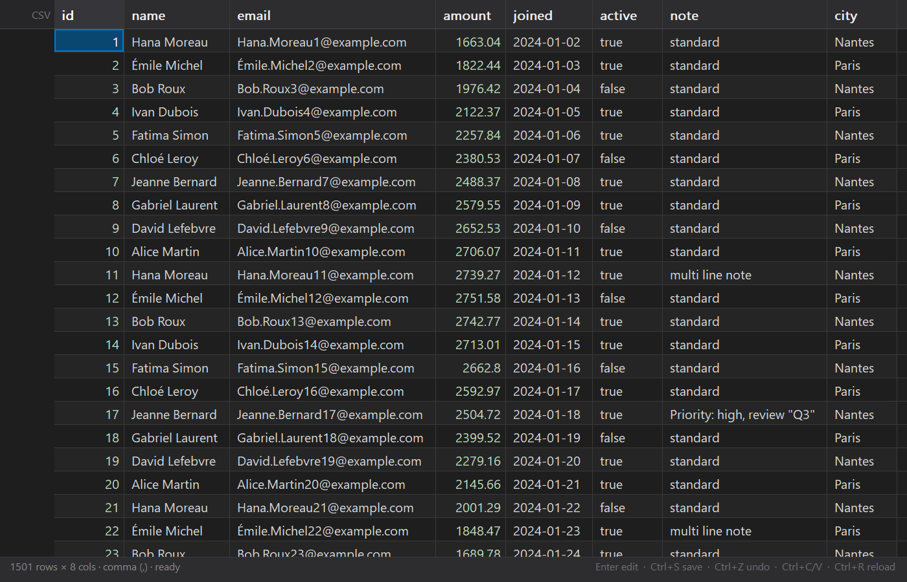

<div align="center">



# HPCSV

**Ouvrez n'importe quel `.csv` comme un vrai tableur.**
Cœur C pur, zéro dépendance, et une extension Zed qui garde l'onglet éditeur comme source de vérité.

<p>
  <a href="LICENSE"></a>
  
  
  
  
  <a href="https://github.com/RedTheFoxx/HPCSV/stargazers"></a>
</p>

</div>

Trois binaires, un seul cœur :

| Binaire | Rôle |
| --- | --- |
| **`HPCSV.exe`** | Tableur natif Win32/GDI : grille virtualisée, édition, annuler/rétablir, presse-papiers. |
| **`hpcs-lsp.exe`** | Serveur LSP en C : diagnostics, hover de cellule, action « ouvrir dans HPCSV ». |
| **`hpcs.exe`** | CLI et outil de diagnostic (`info`, `get`, `set`, `dump`, `bench`). |

> **Pourquoi un binaire natif ?** Les extensions Zed ne peuvent pas dessiner de vue custom
> (webview/panneau) — le RFC *Visual Extension API* est toujours ouvert. HPCSV prend le
> problème par l'autre bout : **l'onglet CSV de Zed reste la source de vérité**, le tableur
> natif édite **le même fichier**, et les deux se synchronisent en direct. Un vrai tableur,
> sans fork de Zed.

---

## Fonctionnalités

**Tableur** — grille virtualisée (fluide sur des millions de lignes) · édition en place ·
en-tête figé et colonnes redimensionnables · sélection rectangulaire · copier/coller TSV
compatible Excel/LibreOffice · annuler/rétablir multi-cellules · détection du séparateur
(`, ; \t |`) · chemins Unicode et drag & drop · sauvegarde atomique (BOM, CRLF et quoting
préservés) · rechargement automatique quand le fichier change sur le disque.

**Extension Zed** — langages **CSV** et **TSV** (tree-sitter, highlighting) · diagnostics
(nombre de champs ≠ en-tête, guillemet non fermé) · hover (adresse, colonne, type, résumé
de la ligne) · code action **`HPCSV: open in spreadsheet`** (`Ctrl+.`).

**Cœur C** — parseur RFC 4180 tolérant (champs quotés, `""`, retours à la ligne embarqués,
BOM, dernière ligne sans `\n`) · index zéro-copie (aucun `malloc` par cellule) · édition
par *splice* sans reparse complet.

---

## Démarrage rapide

```powershell
git clone https://github.com/RedTheFoxx/HPCSV
cd HPCSV
zig build -Doptimize=ReleaseFast
.\zig-out\bin\HPCSV.exe samples\demo.csv
```

**Extension Zed** — après `zig build`, ouvrez `zed: extensions` → **Install Dev Extension**
→ dossier `extension/`. Le serveur `hpcs-lsp` est résolu automatiquement : `zig-out\bin` du
dépôt, `HPCSV_LSP` (chemin complet), dossier de `HPCSV_BIN`, puis `PATH`.

---

## Utilisation

```powershell
hpcs info  samples\demo.csv
hpcs get   samples\demo.csv 2 3          # ligne 2, colonne 3 (1-based)
hpcs set   samples\demo.csv 2 3 "Paris"
hpcs dump  samples\demo.csv 10           # TSV des 10 premières lignes
hpcs bench gros.csv 10                   # débit de parsing
```

<details>
<summary><b>Raccourcis du tableur</b></summary>

| Raccourci | Action |
| --- | --- |
| `↑ ↓ ← →` / `Maj + flèches` | déplacer / étendre la sélection |
| `Ctrl + flèches`, `Début`/`Fin` | bords des données, de la ligne, du document |
| `Entrée` / `F2` / frappe directe | éditer la cellule |
| `Entrée` / `Tab` / `Maj + Tab` | valider et descendre / droite / gauche |
| `Échap` | annuler l'édition ou la sélection |
| `Suppr` | vider la sélection |
| `Ctrl + C` / `Ctrl + V` | copier / coller en TSV |
| `Ctrl + Z` / `Ctrl + Y` | annuler / rétablir |
| `Ctrl + S` / `Ctrl + R` | sauvegarder / recharger |
| `Ctrl + A` / `Ctrl + O` | tout sélectionner / ouvrir un fichier |
| `Ctrl + Entrée` | ajouter une ligne |

Clic-glisser : sélection rectangulaire. Double-clic : édition. Bordure d'en-tête :
redimensionner. Molette : vertical ; `Maj + molette` : horizontal.

</details>

---

## Performances

Build `ReleaseFast`, Zig 0.14.1, fichier de 80,26 Mio (1 000 001 lignes × 8 colonnes) :

| Opération | Temps |
| --- | --- |
| Parsing complet | **79 ms** (≈ 1,0 Gio/s) |
| Édition d'une cellule + réécriture atomique | **~190 ms** |
| Application : parsing + ouverture | ~0,2 s |

Le parsing est mono-passe et zéro-copie ; l'édition ne reparse pas le document : elle
remplace la plage brute de la cellule puis décale les offsets suivants.

---

## Architecture

```
   onglet Zed ──▶┌──────────────────────────┐◀── sauvegarde atomique
   (édition)     │  fichier .csv sur disque │
                 └────────────┬─────────────┘
                              │ watch mtime
                 ┌────────────▼─────────────┐        ┌──────────────────┐
                 │  HPCSV.exe               │        │  hpcs-lsp.exe    │
                 │  C core + Win32          │        │  C, JSON-RPC     │
                 └──────────────────────────┘        └──────────────────┘
                                                        ▲  diagnostics / hover
```

```
HPCSV/
├── core/        hpcs.h + hpcs.c      parseur, index, édition, I/O
├── core/tests/  suite de tests C
├── app/         tableur Win32 (main.c, render.c)
├── lsp/         serveur LSP en C
├── cli/         CLI hpcs
├── extension/   extension Zed (Rust → wasm32-wasip2)
└── samples/     jeux de données de démonstration
```

Détails de conception : [docs/ARCHITECTURE.md](docs/ARCHITECTURE.md).

---

## Compilation

Prérequis : **Zig 0.14.1** (le `build.zig` utilise son API) · **Windows 10/11** pour le
tableur natif (cœur et LSP portables C11) · **Rust** (`wasm32-wasip2`) pour l'extension.

```powershell
zig build                          # debug
zig build -Doptimize=ReleaseFast   # release
zig build test                     # tests du cœur
```

Produit `zig-out/bin/{HPCSV.exe, hpcs-lsp.exe, hpcs.exe}`. Si Zig n'est pas dans le `PATH`,
appelez son chemin complet : `& "C:\tools\zig\zig.exe" build -Doptimize=ReleaseFast`.

<details>
<summary><b>Compilation de l'extension Zed (Windows)</b></summary>

```powershell
cd extension
cargo build --target wasm32-wasip2 --release
```

Zed compile l'extension lui-même à l'installation. Deux pièges fréquents :

1. **`link.exe` introuvable** — Rust utilise MSVC par défaut, qui exige Visual Studio.
   Passez au toolchain GNU :

   ```powershell
   rustup default stable-x86_64-pc-windows-gnu
   rustup target add wasm32-wasip2
   ```

2. **Chemin du dépôt accentué** (ex. `Dépots`) — MinGW n'ouvre pas ces chemins. Préparez
   une copie ASCII et installez la dev extension depuis cette copie :

   ```powershell
   .\scripts\prepare-dev-extension.ps1   # → C:\hpcs-extension
   ```

Après l'installation de Rust, **redémarrez Zed** pour qu'il voie `cargo`/`rustup`.

</details>

<details>
<summary><b>Linter C (clangd)</b></summary>

Sur une machine sans Visual Studio / Windows SDK, clangd ne trouve ni `windows.h` ni les
en-têtes du projet. On lui donne la même cible que Zig via une base de compilation :

```powershell
.\scripts\gen_compile_commands.ps1
# ou : .\scripts\gen_compile_commands.ps1 -Zig C:\tools\zig\zig.exe
```

`compile_commands.json` (gitignoré, propre à la machine) porte le bon
`--target=x86_64-w64-windows-gnu` et les en-têtes MinGW de Zig ; `.clangd` force la cible
pour les fichiers hors base. Rechargez ensuite clangd (`editor: restart language server`).
Une tâche `HPCSV: regenerate clangd database` est fournie dans `.zed/tasks.json`.

</details>

---

## Licence

MIT — voir [LICENSE](LICENSE).
